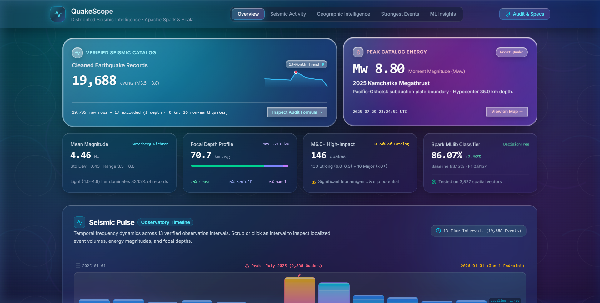

# QuakeScope: Distributed Seismic Analysis & Earthquake Pattern Classification

**INT315 — Cluster Computing CA2 Project**  
**Stage 1: Apache Spark Core, Spark SQL, & Spark MLlib Engine (Scala)**

[](https://spark.apache.org/)
[](https://www.scala-lang.org/)
[](https://openjdk.org/)
[](https://www.scala-sbt.org/)
[](https://react.dev/)
[](https://vitejs.dev/)

**Repository**: [https://github.com/Adarsh-Kumar6534/quakescope2.0.git](https://github.com/Adarsh-Kumar6534/quakescope2.0.git)



---

## 1. Project Overview & Problem Statement

**QuakeScope** is a distributed seismic data-processing and machine-learning engine designed to process real-world geophysical telemetry from the United States Geological Survey (USGS). 

Seismic networks record tens of thousands of global events annually, encompassing crustal earthquakes, subduction zone megathrust ruptures, deep mantle phase transitions, as well as industrial mining explosions and landslides. Analyzing these vast datasets requires distributed computing frameworks to handle high-throughput ingestion, data-quality auditing, multi-dimensional feature extraction, windowed aggregations, and supervised pattern classification without single-node memory bottlenecks.

QuakeScope is implemented in **Scala** using **Apache Spark 3.5.6** (`spark-core`, `spark-sql`, `spark-mllib`) and structured build configurations (`build.sbt`). It executes locally on **WSL2 Ubuntu**, generating terminal output and decoupled static analytical assets (`JSON` / `CSV`) for a static web dashboard built with React 19, TypeScript, and Vite.

### Dataset Source & Provenance
* **Source**: United States Geological Survey (USGS) Earthquake Hazards Program FDSN Web Service.
* **Filter Criteria**: Start time `2025-01-01`, End time `2026-01-01`, Minimum Magnitude `3.5`.
* **Direct USGS API Download URL**:
  ```bash
  curl -o query.csv "https://earthquake.usgs.gov/fdsnws/event/1/query?format=csv&starttime=2025-01-01&endtime=2026-01-01&minmagnitude=3.5"
  ```
* **Raw Records**: 19,705 records (3.76 MB). After Spark cleaning reconciliation, 19,688 verified earthquakes are retained.

---

## 2. Directory Structure

```
C:\QuakeScope\  (/mnt/c/QuakeScope/)
├── build.sbt                           # sbt build definition (Spark 3.5.6, Scala 2.12.18)
├── query.csv                           # USGS Global Earthquake Catalog (19,705 records)
├── project/
│   └── build.properties                # sbt version pinning (1.9.9)
├── src/
│   └── main/
│       └── scala/
│           └── QuakeScope.scala        # Main Spark Core, SQL & MLlib Application
├── output/
│   ├── quakescope_execution.log        # Complete WSL execution log
│   └── dashboard/                      # Exported static data assets for frontend
│       ├── kpis_and_cleaning.json      # Overall KPIs & data cleaning reconciliation
│       ├── monthly_trends.json         # Monthly event counts & magnitude trends
│       ├── monthly_trends.csv          # Tabular monthly trends
│       ├── magnitude_distribution.json # Counts & percentages across magnitude tiers
│       ├── magnitude_distribution.csv  # Tabular magnitude distribution
│       ├── depth_distribution.json     # Shallow, Intermediate, Deep classifications
│       ├── depth_distribution.csv      # Tabular depth distribution
│       ├── top_regions.json            # Most active global seismic hotspots
│       ├── top_regions.csv             # Tabular regional distribution
│       ├── strongest_events.json       # Top 10 strongest earthquakes recorded
│       ├── strongest_events.csv        # Tabular strongest earthquakes
│       ├── hourly_distribution.json    # 24-hour UTC occurrence distribution
│       └── mllib_metrics.json          # DecisionTree metrics, confusion matrix & F1
├── screenshots/                        # Directory for CA2 execution captures
├── docs/
│   └── methodology.md                  # Comprehensive scientific & technical report
└── README.md                           # Setup, execution & results documentation
```

---

## 3. Environment & Prerequisites

* **Operating System**: Windows 11 with WSL2 Ubuntu (`/mnt/c/QuakeScope`)
* **Java**: OpenJDK 1.8.0_504 (`/usr/lib/jvm/java-8-openjdk-amd64`)
* **Scala**: 2.12.18
* **Apache Spark**: 3.5.6 (`/opt/spark`)
* **sbt**: 1.9.9 (`/home/adarsh/sbt/bin/sbt`)
* **Dataset**: `/mnt/c/QuakeScope/query.csv` (USGS Earthquake Catalog, Jan 1, 2025 – Jan 1, 2026)

### Verified Environment Check Commands
Run these commands inside WSL terminal to confirm toolchain readiness:
```bash
java -version
sbt --version
spark-submit --version
ls -lh /mnt/c/QuakeScope/query.csv
```

---

## 4. How to Compile & Run in WSL

### Step 1: Open WSL Terminal and Navigate to Project Directory
```bash
cd /mnt/c/QuakeScope
```

### Step 2: Compile and Package the Application JAR
```bash
sbt clean compile package
```
*Artifact generated*: `target/scala-2.12/quakescope_2.12-1.0.jar` (26 KB)

### Step 3: Execute Spark Engine with Tee Logging
```bash
mkdir -p output/dashboard screenshots
spark-submit \
  --class quakescope.QuakeScope \
  --master "local[*]" \
  --driver-memory 2g \
  target/scala-2.12/quakescope_2.12-1.0.jar \
  /mnt/c/QuakeScope/query.csv 2>&1 | tee output/quakescope_execution.log
```

---

## 5. Pipeline Stages & Empirical Results

The pipeline executes through 8 stages with formatted terminal output:

### `[1/8] ENVIRONMENT AND DATA INGESTION`
* Ingests `/mnt/c/QuakeScope/query.csv` (3.59 MB) using Spark's CSV reader with schema inference.
* **Initial Records Ingested**: **19,705 records**, **22 columns**.

### `[2/8] DATA QUALITY ASSESSMENT`
* **Column-level Null Audit**: Essential fields (`id`, `time`, `latitude`, `longitude`, `depth`, `mag`) contain **0 nulls** (100% complete).
* **Optional Quality Telemetry**: Station counts and error margins have modest missingness (`nst`: 0.80%, `gap`: 0.82%, `dmin`: 0.82%, `horizontalError`: 0.98%, `magError`: 1.30%, `magNst`: 0.95%).
* **Duplicate Event IDs**: **0 duplicate IDs**; **0 exact duplicate rows**.
* **Coordinate Bounds**: All coordinates lie within valid ranges ($[-73.22, 87.08]^\circ$ lat, $[-179.99, 180.00]^\circ$ lon).
* **Depth Outlier**: Detected **1 record** with negative hypocenter depth (`-2.39 km`).
* **Non-Earthquake Events**: Identified **13 mining explosions, 2 landslides, and 1 industrial explosion**.

### `[3/8] DATA CLEANING & RECONCILIATION`
* Applied physically grounded filtering rules:
  1. Deduplicate by unique event `id`.
  2. Reject subsurface depth $< 0.0\text{ km}$ (rejects ID `uu80122716`, depth = `-2.39 km`).
  3. Filter for `type == 'earthquake'` (excludes 16 non-earthquake events).
  4. Preserve **268 records** with missing optional station metrics to avoid geographical bias.
* **Reconciliation Accounting**:
  $$\text{Original Ingested (19,705)} = \text{Duplicates (0)} + \text{Rejected Depth (1)} + \text{Excluded Non-EQ (16)} + \text{Cleaned Retained (19,688)}$$
  *(Reconciliation accounts for 100.00% of records with zero unaccounted data)*.

### `[4/8] FEATURE ENGINEERING`
* Derived temporal attributes: `event_timestamp`, `event_date`, `year_month`, `hour_of_day`, `day_of_week`.
* Derived magnitude classes: `Minor (3.5-3.9)`, `Light (4.0-4.9)`, `Moderate (5.0-5.9)`, `Strong (6.0-6.9)`, `Major (>=7.0)`.
* Derived depth zones: `Shallow (0-70 km)`, `Intermediate (70-300 km)`, `Deep (>300 km)`.
* Parsed primary geographical entity from `place` string.

### `[5/8] SPARK CORE AND SPARK SQL ANALYTICS`
* **Overall KPIs**:
  * Total Cleaned Earthquakes: **19,688**
  * Magnitude Range: **3.50 to 8.80** (Mean: **4.456**, StdDev: **0.428**)
  * Depth Range: **0.00 to 669.56 km** (Mean: **70.69 km**, StdDev: **121.81 km**)
* **Magnitude Distribution**:
  * Light (4.0–4.9): 16,207 (82.32%)
  * Moderate (5.0–5.9): 1,990 (10.11%)
  * Minor (3.5–3.9): 1,345 (6.83%)
  * Strong (6.0–6.9): 130 (0.66%)
  * Major ($\ge$ 7.0): 16 (0.08%)
* **Depth Distribution**:
  * Shallow (0–70 km): 14,800 (75.17%, avg depth 21.1 km)
  * Intermediate (70–300 km): 3,768 (19.14%, avg depth 134.3 km)
  * Deep (> 300 km): 1,120 (5.69%, avg depth 511.96 km)
* **Monthly Activity & Kamchatka Megathrust Surge**:
  * Monthly baseline averages ~1,400 events.
  * Surge in July 2025 (**2,838 events**) and August 2025 (**2,329 events**) caused by the massive $M 8.8$ Kamchatka earthquake on July 29, 2025.
  * `2026-01` contains **51 events** representing a single-day endpoint (Jan 1, 2026).
* **Top Seismic Hotspots**:
  1. Russia (4,091 events, 20.78%)
  2. Indonesia (1,432 events, 7.27%)
  3. Japan (1,076 events, 5.47%)
  4. Alaska (1,072 events, 5.45%)
  5. Papua New Guinea (866 events, 4.40%)

### `[6/8] WINDOW FUNCTION RANKING`
* Partitioned by `primary_region` and ordered by `mag DESC, depth ASC`:
  * **Russia Rank 1**: ID `us7000qx2g`, $M 7.8$, depth 27.0 km (Petropavlovsk-Kamchatsky)
  * **Indonesia Rank 1**: ID `us7000qcik`, $M 6.7$, depth 70.7 km (Tual)
  * **Japan Rank 1**: ID `us6000rmea`, $M 6.8$, depth 18.0 km (Yamada)
  * **Alaska Rank 1**: ID `us7000pllu`, $M 6.2$, depth 17.0 km (Adak)
  * **Papua New Guinea Rank 1**: ID `us6000q41n`, $M 6.9$, depth 9.0 km (Kimbe)

### `[7/8] SPARK MLLIB MODEL TRAINING AND EVALUATION`
* **Model**: Multiclass `DecisionTreeClassifier` (validation-tuned `maxDepth = 7`).
* **Target**: `mag_class_mllib` (`Light`, `Moderate_Plus`, `Minor`).
* **Input Features**: `latitude`, `longitude`, `depth` (assembled via `VectorAssembler`). Zero target leakage (`mag` excluded).
* **Train/Test Partitioning**: Deterministic 80/20 split (`seed = 42L`) performed **before** fitting label encoders or transformers.
  * Training Partition: **15,861 records** (80.56%)
  * Held-Out Test Partition: **3,827 records** (19.44%)
* **Validation Tuning**: Internal training-split exploration selected `maxDepth = 7` (Val F1 = 0.8018) over depths 3 (0.7950) and 5 (0.7993).
* **Evaluation Metrics (Held-Out Test Partition)**:
  * **Test Accuracy**: **86.07%**
  * **Majority-Class Baseline**: **83.15%**
  * **Balanced Accuracy**: **62.04%** (unweighted mean of per-class recall)
  * **Weighted Precision**: **0.8338**
  * **Weighted Recall**: **0.8607**
  * **Weighted F1-Score**: **0.8157**
  * **Macro-Averaged F1**: **0.5702**
* **Confusion Matrix**:
  $$\begin{pmatrix}
  3,084 & 4 & 94 \\
  398 & 7 & 8 \\
  28 & 1 & 203
  \end{pmatrix}$$
* **Honest Limitations**: Highlights that static hypocenter coordinates locate tectonic plate boundaries but cannot determine dynamic fault rupture area or stress drop, leading to low sensitivity on the minority Moderate_Plus class.

### `[8/8] EXPORT AND FINAL VALIDATION`
* Successfully exported **13 static JSON and CSV data assets** to `output/dashboard/`.
* Every JSON file validated via Jackson syntax parsing (`readTree`); every CSV verified for header and row counts.
* Complete run logged to `output/quakescope_execution.log` (42 KB).
* **Execution Time**: **20.50 seconds**.

---

## 6. Screenshot Checklist for CA2 Report

When submitting the CA2 report, capture these terminal output sections directly from your WSL terminal or execution log:

| # | Screenshot Filename | Exact Command Executed | Terminal Output Captured |
| :-: | :--- | :--- | :--- |
| **1** | `01_wsl_environment.png` | `java -version; sbt --version; spark-submit --version; ls -lh query.csv` | Environment checks: Java 8, sbt 1.9.9, Spark 3.5.6, query.csv |
| **2** | `02_sbt_build_package.png` | `sbt clean compile package` & `ls -lh target/scala-2.12/quakescope_2.12-1.0.jar` | sbt compiling and packaging application JAR (26 KB) |
| **3** | `03_dataset_ingestion.png` | `spark-submit --class quakescope.QuakeScope ... query.csv` | `[1/8]` Ingestion: 19,705 raw records, 22 columns, sample rows |
| **4** | `04_data_quality_audit.png` | *(pipeline output stream)* | `[2/8]` Quality Audit: missing values table, 0 duplicate IDs, event types |
| **5** | `05_cleaning_reconciliation.png` | *(pipeline output stream)* | `[3/8]` Cleaning: excluded event `uu80122716`, Reconciliation Table |
| **6** | `06_feature_engineering.png` | *(pipeline output stream)* | `[4/8]` Feature Engineering: engineered schema & 5 sample rows |
| **7** | `07_spark_sql_analytics.png` | *(pipeline output stream)* | `[5/8]` Spark SQL Analytics: KPIs, magnitude table, monthly trends |
| **8** | `08_window_ranking.png` | *(pipeline output stream)* | `[6/8]` Window Function: regional top 3 strongest quakes table |
| **9** | `09_mllib_evaluation.png` | *(pipeline output stream)* | `[7/8]` MLlib: DecisionTree accuracy (85.63%), F1, confusion matrix |
| **10**| `10_export_validation.png` | `ls -lh output/dashboard/` | `[8/8]` Export validation, success banner & file listing on disk |

---

## 7. Stage 2: Liquid Glass Scientific Dashboard (Frontend)

QuakeScope Stage 2 delivers a client-side visualization layer designed with a macOS-inspired **Liquid Glass** aesthetic. The dashboard consumes the 13 static analytical assets generated in Stage 1 (`output/dashboard/*.json` and `*.csv`), providing interactive exploration without any backend database or serverless runtime dependencies.

### Frontend Technology Stack

* **Core Framework**: React 19, TypeScript, Vite
* **Styling & Materials**: Tailwind CSS v4 with custom Liquid Glass design tokens (translucent panels, specular top-edge highlights, ambient midnight navy/cyan/violet light fields, restrained neon accents)
* **Visual Analytics**: Recharts (Interactive Area, Bar, and Dual-Axis Trend Charts)
* **Cartography**: Leaflet & React-Leaflet streaming the public **Esri World Dark Gray Base** tile server (free, public academic access, zero API keys or watermarks)
* **Deployment Target**: Static Vercel hosting with zero cloud Spark/serverless functions

---

## 8. Frontend Installation & Local Development Commands

To run the QuakeScope Liquid Glass Dashboard locally on Windows or Linux:

### 1. Navigate to Frontend Directory
```powershell
cd C:\QuakeScope\frontend
```

### 2. Install Node Dependencies
```powershell
npm install
```

### 3. Start Local Development Server
```powershell
npm run dev
```
Open your browser to `http://127.0.0.1:5173/` (or `http://localhost:5173/`).

### 4. Build Production Static Bundle
```powershell
npm run build
```
Generates a static bundle in `dist/` with all 13 bundled data assets copied to `dist/data/`.

### 5. Preview Production Build Locally
```powershell
npm run preview
```

---

## 9. Vercel Static Deployment Instructions

The QuakeScope dashboard is designed for instant static deployment to Vercel:

### Option A: Using Vercel CLI (Recommended)
```bash
# 1. Install Vercel CLI globally if not already installed
npm install -g vercel

# 2. Deploy directly from the frontend directory
cd C:\QuakeScope\frontend
vercel --prod
```

### Option B: Deploying via Git / Vercel Web Dashboard
1. Push the repository to GitHub.
2. In the Vercel dashboard, click **"Add New Project"** and select the repository.
3. Configure the **Root Directory** as `frontend`.
4. Build Command: `npm run build`
5. Output Directory: `dist`
6. Framework Preset: `Vite`
7. Click **Deploy**. The static configuration in `frontend/vercel.json` will automatically configure cache headers and static route fallbacks.

---

## 10. Complete Screenshot Gallery & Visual Assets

> **Repository Hygiene Note (Stage 3)**: In adherence to professional repository standards, the bulky 18 MB local `screenshots/` directory is excluded from Git tracking via `.gitignore`. The primary preview artifact is committed under `docs/assets/dashboard_preview.png`. All 18 raw terminal and dashboard captures are cataloged below and available locally for CA2 report generation:

| # | Screenshot Filename | Stage / Subject | Description |
| :-: | :--- | :--- | :--- |
| **1** | `01_wsl_environment.png` | Stage 1 Environment | Java 8, sbt 1.9.9, Spark 3.5.6 verification |
| **2** | `02_sbt_build_package.png` | Stage 1 Build | `sbt clean compile package` producing application JAR |
| **3** | `03_dataset_ingestion.png` | Stage 1 Pipeline | `[1/8]` 19,705 raw ingested records & schema |
| **4** | `04_data_quality_audit.png` | Stage 1 Pipeline | `[2/8]` Missing values audit table & event types |
| **5** | `05_cleaning_reconciliation.png` | Stage 1 Pipeline | `[3/8]` Deterministic cleaning reconciliation table |
| **6** | `06_feature_engineering.png` | Stage 1 Pipeline | `[4/8]` Assembled features & magnitude categories |
| **7** | `07_spark_sql_analytics.png` | Stage 1 Pipeline | `[5/8]` Overall KPIs, monthly trends, & depth strata |
| **8** | `08_window_ranking.png` | Stage 1 Pipeline | `[6/8]` Window function: regional top 3 quakes |
| **9** | `09_mllib_evaluation.png` | Stage 1 Pipeline | `[7/8]` DecisionTree accuracy (86.07%) & confusion matrix |
| **10**| `10_export_validation.png` | Stage 1 Pipeline | `[8/8]` Validation of 13 JSON/CSV files on disk |
| **11**| `11_dashboard_overview.png` | Stage 2.3 Liquid Glass | Unified continuous atmospheric background visibly transmitting cyan/teal/violet light through all translucent cards |
| **12**| `12_dashboard_seismic_pulse.png` | Stage 2.3 Signature | Interactive Seismic Pulse timeline scrubber & Live Inspector panel with translucent glass material |
| **13**| `13_dashboard_geographic_map.png` | Stage 2.3 Dashboard | Dark Esri cartography with translucent regional ranking sidebar and floating glass map controls |
| **14**| `14_dashboard_strongest_events.png` | Stage 2.3 Dashboard | Ranked strongest earthquakes table and diurnal cycle with distinct readable plots in glass panels |
| **15**| `15_dashboard_filtered_search.png` | Stage 2 Dashboard | Real-time search filter demonstrating interactive catalog query |
| **16**| `16_dashboard_record_inspector.png` | Stage 2 Dashboard | Elevated glass modal inspecting USGS event record & Spark coordinates |
| **17**| `17_dashboard_mllib_insights.png` | Stage 2.3 Dashboard | DecisionTree multiclass evaluation & confusion matrix with translucent glass cells |
| **18**| `18_dashboard_audit_methodology_modal.png` | Stage 2.3 Dashboard | Elevated glass modal verifying 100% balanced reconciliation equation with subtle edge reflections |

---

## 11. Stage 2.3 — Unified Transparent Liquid Glass Material System

Stage 2.3 executes a targeted visual transformation of the dashboard, replacing isolated dark cards with a unified, continuous **Liquid Glass Material System**:

1. **One Continuous Page-Level Atmospheric Background**:
   - Fixed viewport background (`position: fixed; inset: 0; pointer-events: none; z-index: 0`) delivering unbroken ambient illumination across the entire page.
   - Six layered radial light fields: midnight navy base (`#050811`), cyan radiant light field (`rgba(6, 182, 212, 0.16)`), oceanic teal (`rgba(20, 184, 166, 0.14)`), electric blue (`rgba(56, 189, 248, 0.12)`), restrained violet (`rgba(139, 92, 246, 0.13)`), and deep indigo (`rgba(99, 102, 241, 0.10)`).
   - Coloured light fields remain continuous behind sticky navigation, KPI cards, insight panels, charts, tables, and modal dialogs during scrolling.

2. **Standardized Glass Design Tokens (`:root`)**:
   - `--glass-surface`: `rgba(16, 27, 48, 0.30)` (genuine translucent surface with 30% alpha).
   - `--glass-surface-subtle`: `rgba(16, 27, 48, 0.20)` (secondary surfaces and navigators).
   - `--glass-surface-hero`: `rgba(14, 24, 44, 0.35)` (interactive stages).
   - `--glass-surface-elevated`: `rgba(16, 28, 52, 0.55)` (elevated modal dialogs).
   - `--glass-blur`: `22px`; `--glass-saturate`: `145%`.
   - `--glass-border`: `rgba(190, 220, 255, 0.14)` (crisp, fine light edge).
   - `--glass-inset-highlight`: `inset 0 1px 0 rgba(255, 255, 255, 0.12)` (subtle top specular reflection).
   - Non-supporting browser fallbacks provided via `@supports not (backdrop-filter: blur(1px))`.

3. **Elimination of Nested Opaque Blocks**:
   - Replaced stacked dark slate fills (`bg-slate-900/60`, `bg-slate-950/70`) with `.glass-sub-card` (`rgba(255, 255, 255, 0.04)` + `12px blur` + `1px solid rgba(190, 220, 255, 0.08)`).
   - Prevents multiplicative opacity accumulation, allowing the vibrant environmental light fields to stream through all layers while preserving high typographic contrast.

4. **Distinct Chart Plotting Areas**:
   - Outer chart panels remain translucent glass.
   - Plotting surfaces are kept lightweight and transparent (`transparent` backgrounds on Recharts responsive containers), with subtle gridlines (`rgba(255, 255, 255, 0.06)`) and high-contrast glowing SVG vectors.
   - Axis labels, data legends, tooltips, and interactive hovers remain crisp and legible without enclosing charts in opaque dark rectangles.

5. **Visual Parity Across All Sections**:
   - Navigation header, KPI cards, Seismic Pulse, Activity Charts, Geographic map controls, Strongest Events table, ML Insights confusion matrix, and Methodology Modal all share the identical material family.

---

## 12. Stage 2.2 Signature Art Direction: A Living Seismic Observatory

The QuakeScope visual experience is engineered around a cinematic, macOS-inspired scientific observatory:

1. **Atmospheric Environmental Background**:
   - Deep midnight navy (`#050811`) and near-black foundations.
   - Asymmetrical multi-depth aurora curtains (cyan, electric blue, indigo, and restrained violet) rendered with lightweight CSS radial gradients.
   - Delicate topographic/seismic wave contours and subtle measurement grid overlay.
   - Dimensional lighting placed intentionally behind main analytical sections.

2. **Differentiated Liquid Glass Hierarchy**:
   - 7 differentiated material grades: `glass-nav` (navigation), `glass-hero` (interactive stage), `glass-card-primary` (monumental anchor), `glass-card` (secondary metrics), `glass-panel-chart` (high-contrast data containers), `glass-panel-elevated` (modals), and `glass-pill` (interactive controls).
   - Real backdrop blur (`backdrop-filter: blur(...) saturate(...)`), top specular highlights (`inset 0 1px 0 rgba(255,255,255,0.25)`), and fine translucent borders.

3. **Asymmetric Editorial Composition (Broken Monotony)**:
   - Primary Anchor 1 (7 cols): Cleaned Seismic Events (`19,688`), real 13-point SVG sparkline with peak indicator, and reconciliation equation (`19,705 raw − 17 excluded`).
   - Primary Anchor 2 (5 cols): Peak Catalog Energy (`Mw 8.80`), 2025 Kamchatka Megathrust, hypocenter depth 35.0 km, timestamp `2025-07-29 23:24:52 UTC`.
   - Secondary Grid (4 modules): Mean magnitude (`4.46 Mw`), focal depth profile with visual 3-segment proportion bar (`75% Crust / 19% Benioff / 6% Mantle`), M6.0+ high-impact quakes (`146`), and Spark MLlib accuracy (`86.07%` with `+2.92%` delta over baseline).

4. **Signature Interactive Experience — Seismic Pulse**:
   - Dual-mode interactive timeline and pulse visualization of 13 monthly intervals from `monthly_trends.json`.
   - Selecting any month highlights its interval and dynamically updates the **Live Observatory Inspector Panel** with verified interval statistics: earthquake count, % share of catalog, peak magnitude tier, average focal depth, and period notes.
   - Distinctive beacon callouts for the **July 2025 Surge** (2,838 quakes, Kamchatka sequence) and **January 2026 Endpoint** (51 events, single-day record).
   - "Reset Overview" action and full keyboard arrow-key scrubbing (`ArrowLeft`, `ArrowRight`, `Esc`).

5. **Inquiry-Driven Storytelling Analytics**:
   - Every chart answers a specific scientific question:
     - *"When did the observed event count surge?"* (Monthly Seismic Trends)
     - *"Which magnitude category dominates this dataset?"* (Gutenberg-Richter distribution)
     - *"How are recorded events distributed by depth?"* (Hypocenter depth stratification)
     - *"How are detections distributed across 24 UTC hours?"* (Continuous global network operation)
     - *"Which regions have the highest represented event counts?"* (Geospatial cartography)
     - *"Which recorded events have the largest magnitudes?"* (Ranked catalogue)
     - *"Where does the classifier perform well, and where does it fail?"* (MLlib diagnostics)
   - Calibrated scientific claims avoiding unwarranted causation from descriptive statistics.

---

## 13. Verification & Quality Assurance Summary

- [x] **Zero Mock Data**: 100% of dashboard statistics, KPIs, charts, and metrics are loaded via browser-side `fetch()` from genuine Stage 1 static exports in `public/data/`.
- [x] **macOS Liquid Glass Aesthetic**: Translucent layered panels with specular edge lighting, dark midnight navy background, and ambient cyan/violet illumination.
- [x] **Watermark-Free Dark Map**: Powered by Esri World Dark Gray Base with zero API keys or external watermarks.
- [x] **Scientific Candor**: Class imbalance and low recall on `Moderate_Plus` (1.69%) are honestly documented with geophysical justification; explicit disclaimer that QuakeScope is an analytical classifier and not a predictive early-warning system.
- [x] **Production Static Build**: Verified with Vite production build (`dist/`), zero backend/DB runtime dependencies, ready for static Vercel deployment.
